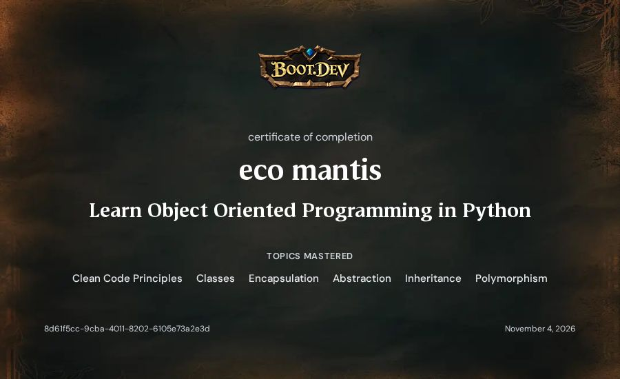
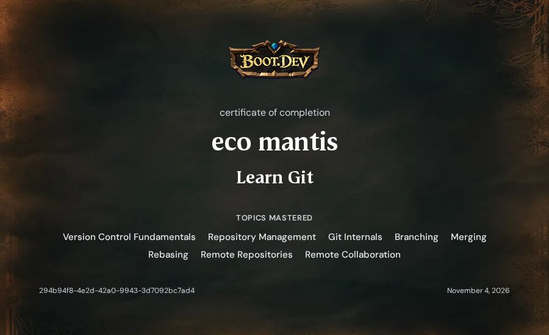
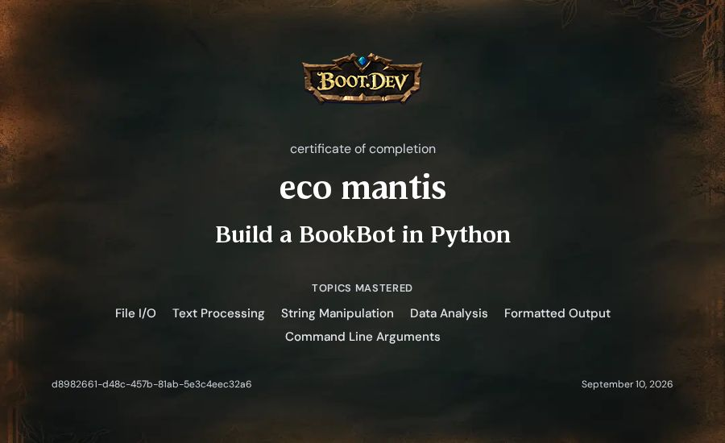
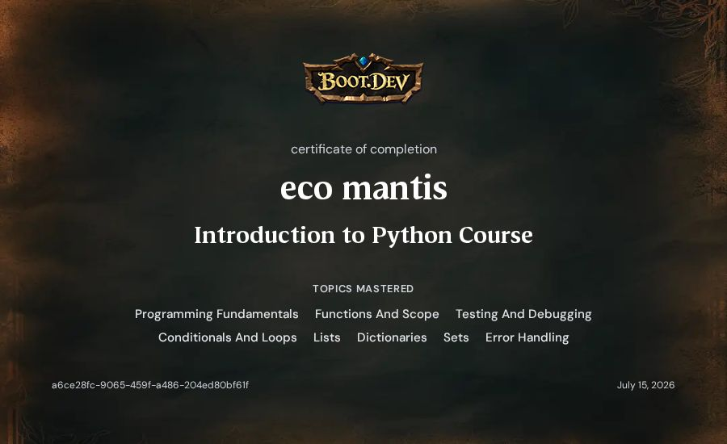

# psyo

Backend developer. Public repos here are coursework and small demos. Private repos stay private, and secrets stay out of git.

I go by psyo. This GitHub login stays [ecomantis](https://github.com/ecomantis) because the username psyo is already taken.

## Public work

- [bookbot](https://github.com/ecomantis/bookbot) counts words and characters in a text file. Python, from the Boot.dev curriculum.
- [webflyx](https://github.com/ecomantis/webflyx) is the Git course repo. Ignored files were left on the machine on purpose.
- [wedme.io](https://github.com/ecomantis/wedme.io) is a static landing page for a Cape Winelands wedding planner.

Tiny Titans is an ecology app. The source is private, so it is not linked here.

An Asteroids game in Python and Pygame is in progress on my machine. It is not published yet.

## Certificates

These are the Boot.dev certificates on this account. Each image is the certificate Boot.dev issued.

  
  

  
  

Learn Linux was completed on 9 September 2026.

## This account

The login is [ecomantis](https://github.com/ecomantis). On X I am [psyosymbiosis](https://x.com/psyosymbiosis).

`TheZenBuda`, `TheZenbUDA`, and `TheRealbUDA` are retired. A link that still uses one of those names is stale. Do not push to it, and do not send it a token or a password.
